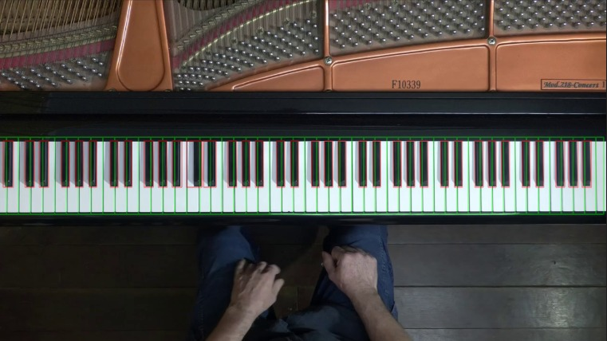
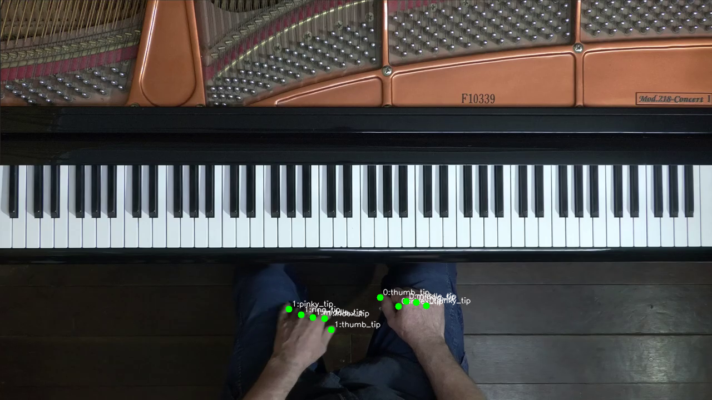

# Piano Keyboard and Hand Analysis from Video

A computer vision pipeline for estimating pressed piano keys from RGB video. Keyboard geometry, hand landmarks, and temporal analysis are combined to produce per-frame key estimates and an annotated video.

Developed as a team project for **Image Analysis and Computer Vision at Politecnico di Milano (2026)**.

**Technologies:** Python, OpenCV, MediaPipe Hands, NumPy, pandas, scikit-image, Matplotlib.

## Visual Examples

### Keyboard and Key Detection



Detected key regions are overlaid on the keyboard image.

### Hand Landmarks and Fingertips



Hand landmarks are extracted to locate fingertips and analyse finger movement.

## Project Overview

Pressed piano keys are estimated from a monocular video without instrument-mounted sensors.

The main challenges include:

- Key boundaries being obscured by hands.
- Fingertips moving above keys without pressing them.
- Reflections, motion blur, and partial occlusion.
- Matching fingertip positions with the correct key regions.

The task is divided into three stages. Intermediate results are saved so that each stage can be inspected separately.

## Processing Pipeline

| Stage | Method | Outputs |
| --- | --- | --- |
| **1. Preparation** | Frames are sampled and filtered. A keyboard reference frame is selected. White and black key regions are extracted. | Cleaned frames, reference image, key coordinates, and key overlays |
| **2. Hand analysis** | MediaPipe landmarks are extracted. Fingertip trajectories are refined. Finger bending and temporal filtering are used for press estimation. | Tracked fingertips, finger landmarks, and per-finger press estimates |
| **3. Integration** | Fingertips are mapped to key regions. Key assignments are combined with press estimates. | Pressed-key estimates per frame and an annotated video |

## Technical Approach

### Frame Extraction and Reference Selection

- Video frames are sampled at a configurable rate.
- Histogram similarity and mean squared error are used for frame filtering.
- A candidate keyboard reference is selected using changes within the keyboard region.
- Automatic keyboard region selection and manual ROI selection are supported.

Low motion is used as a reference-selection criterion. The absence of hands is not guaranteed by this criterion alone.

### Keyboard and Key Detection

- Keyboard geometry is estimated from the reference image.
- White and black key regions are extracted.
- Key coordinates are stored in JSON files.
- Detection overlays are generated for visual inspection.

### Hand and Fingertip Analysis

- A pretrained **MediaPipe Hands** model is used for hand landmark detection.
- Fingertip coordinates are extracted for both hands.
- Temporal processing is applied to refine fingertip trajectories.
- Finger-bending scores are calculated from landmark distances.
- Sequence-dependent thresholds and temporal postprocessing are used to estimate press states.

### Fingertip-to-Key Mapping

- Fingertip coordinates are compared with detected key regions.
- Black-key regions are checked before white-key regions.
- A nearest-white-key fallback is used when no region contains the fingertip.
- Key assignments are combined with per-finger press estimates.

## Installation

Clone the repository:

```bash
git clone https://github.com/H-I-M-I/Piano-Keyboard-Analysis.git
cd Piano-Keyboard-Analysis
```

Create a virtual environment:

```bash
python -m venv .venv
```

Activate it on Windows PowerShell:

```powershell
.venv\Scripts\Activate.ps1
```

Or on macOS/Linux:

```bash
source .venv/bin/activate
```

Install the recorded dependencies:

```bash
python -m pip install -r requirements.txt
```

Dependency compatibility should be checked for the selected Python version.

## Usage

All commands must be run from the repository root.

Input videos must be placed at:

```text
data/raw_videos/<video_name>.mp4
```

A sample video is included at `data/raw_videos/piano_video_1.mp4`.

### 1. Prepare Frames and Detect Keys

```bash
python -m iacv prepare --video piano_video_1
```

For manual keyboard region selection:

```bash
python -m iacv prepare --video piano_video_1 --manual-roi
```

A desktop display is required for interactive ROI selection.

### 2. Analyse Hands and Estimate Finger Presses

```bash
python -m iacv hands --video piano_video_1
```

### 3. Map Fingertips to Keys and Render Results

```bash
python -m iacv render --video piano_video_1
```

The three stages must be executed in this order. Video names must be passed without the `.mp4` extension.

### Preparation Options

| Option | Default | Description |
| --- | --- | --- |
| `--fps` | `10` | Requested frame sampling rate |
| `--maxframes` | `600` | Frame sampling limit |
| `--deviation` | `1.0` | Histogram similarity filtering tolerance |
| `--save-sampled` | Disabled | Intermediate sampled frames are also saved |
| `--manual-roi` | Disabled | The keyboard region is selected interactively |

## Outputs

| Path | Contents |
| --- | --- |
| `data/frames/<video_name>/cleaned/` | Filtered video frames |
| `artifacts/<video_name>/keys/` | Reference image, key coordinates, rotation angle, and key overlay |
| `artifacts/<video_name>/hands/` | Fingertip trajectories, hand landmarks, and press estimates |
| `results/<video_name>/fingertips_to_keys.csv` | Key assignments for tracked fingertips |
| `results/<video_name>/pressed_keys_per_frame.csv` | Estimated pressed keys for each processed frame |
| `results/<video_name>/visualization.mp4` | Annotated result video |

## Evaluation

Qualitative evaluation was performed on multiple piano-playing videos recorded with a static camera.

Keyboard regions, key overlays, and integrated detections were visually inspected. Different video resolutions and quality levels were considered.

Examples and experimental observations are provided in the [project report](Report/main.pdf). No numerical accuracy benchmark is reported for this implementation.

## Limitations

- A static camera and a fixed keyboard position are assumed.
- Detection may be affected by reflections, motion blur, and severe occlusion.
- Finger bending is used as a proxy for a key press. Physical contact is not directly measured.
- Key assignments depend on the accuracy of key regions and fingertip coordinates.
- Thresholds and mapping tolerances may require adjustment for different recording conditions.

## Repository Structure

| Location | Purpose |
| --- | --- |
| `iacv/` | Command-line entry points and pipeline orchestration |
| `src/frames_extractor.py` | Video frame sampling and filtering |
| `src/frame_without_hands_extractor.py` | Keyboard ROI and reference-frame selection |
| `src/keys_extraction.py` | White and black key extraction |
| `src/hands/` | Hand landmarks, fingertip refinement, and press estimation |
| `src/render/` | Fingertip-to-key mapping and visualization |
| `data/raw_videos/` | Input piano videos |
| `Report/` | Project report and supporting figures |

## Documentation

[Read the Project Report](Report/main.pdf)
